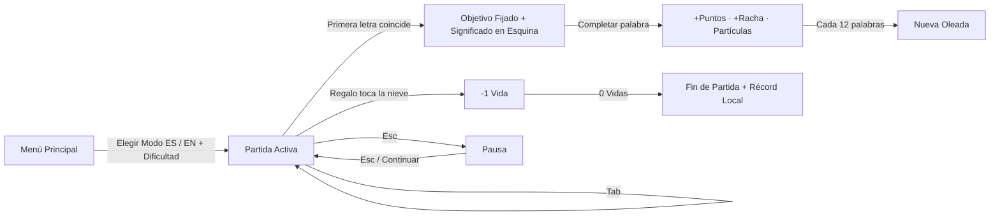

<div align="center">


<br />

# 🎄 Taller de Papá Noel — Mecanografía Navideña

**Defiende la Nochebuena a golpe de teclado.**  
Atrapa los regalos que caen del cielo estrellado antes de que toquen la nieve, encadena rachas multiplicadoras, activa poderes mágicos y domina **Phrasal Verbs en inglés** con significado en vivo.

<p>
  <a href="#-inicio-rápido"><kbd>🚀 Jugar Ahora</kbd></a> •
  <a href="#-modos-de-vocabulario"><kbd>🇬🇧 Phrasal Verbs</kbd></a> •
  <a href="#-power-ups-mágicos"><kbd>⚡ Power-Ups</kbd></a> •
  <a href="#-dificultades-y-puntuación"><kbd>🏆 Dificultades</kbd></a> •
  <a href="#-arquitectura-del-proyecto"><kbd>🧩 Arquitectura</kbd></a>
</p>

> ✨ **100% HTML5 + Canvas 2D + Web Audio API** · Sin instalaciones, sin dependencias externas, funciona directo con doble clic en `index.html`.

</div>

---

## 🎮 Inicio Rápido

1. Abre **`index.html`** con doble clic en tu navegador favorito (Chrome, Edge, Firefox, Brave).
2. Elige tu modo: **`🎄 Navidad (ES)`** o **`🇬🇧 Phrasal Verbs (EN)`**.
3. Selecciona una dificultad (`Duende`, `Reno Veloz` o `Papá Noel`) y pulsa <kbd>Enter</kbd> o **🎁 ¡Empezar a Empaquetar!**.

---

## 🌍 Modos de Vocabulario

| Característica | 🎄 Navidad (ES) | 🇬🇧 Phrasal Verbs (EN) |
| :--- | :--- | :--- |
| **Contenido** | Léxico navideño en español (palabras y frases festivas) | **58 Phrasal Verbs** en inglés en 3 niveles de complejidad |
| **Asistencia visual** | Resaltado de prefijo en tiempo real + indicador inferior | **Panel de Significado en esquina inferior derecha** (`Próximo` / `Fijado`) |
| **Ejemplo en vivo** | — | Significado en español + oración contextual en inglés |
| **Power-Ups** | `escarcha`, `ventisca`, `destello`, `bengala`, `chocolate`, `abrazo` | `snowstorm`, `frostbite`, `starlight`, `fireworks`, `hot cocoa`, `warm hug` |
| **Récord personal** | Guardado independiente en `localStorage` | Guardado independiente en `localStorage` |

<details>
<summary><b>📘 Ver muestra de Phrasal Verbs incluidos por nivel (clic para desplegar)</b></summary>

<br />

| Nivel | Phrasal Verb | Significado en Español | Ejemplo |
| :--- | :--- | :--- | :--- |
| **Tier 1** | `wrap up` | Envolver (un regalo) / Terminar algo | *Let's wrap up the presents tonight.* |
| **Tier 1** | `put up` | Colocar o colgar adornos / el árbol | *We put up the Christmas tree early.* |
| **Tier 1** | `stay up` | Quedarse despierto hasta tarde | *We stay up waiting for midnight.* |
| **Tier 2** | `hang up` | Colgar (calcetines, guirnaldas) | *Hang up the stockings by the chimney.* |
| **Tier 2** | `cheer up` | Animarse / Alegrar a alguien | *Holiday carols always cheer me up.* |
| **Tier 2** | `snow in` | Quedar atrapado por la nieve | *We got snowed in at the mountain lodge.* |
| **Tier 3** | `look forward to` | Esperar algo con mucha ilusión | *I look forward to the holidays all year.* |
| **Tier 3** | `get together` | Reunirse / Juntarse en familia | *Families get together on Christmas Eve.* |
| **Tier 3** | `stock up on` | Abastecerse de algo en cantidad | *Stock up on gingerbread cookies.* |

</details>

---

## ⚡ Power-Ups Mágicos

De vez en cuando caerá un **orbe especial brillante**. Escribe su palabra para activar su magia:

| Icono | Navidad (ES) | Phrasal Verbs (EN) | Efecto en partida |
| :---: | :--- | :--- | :--- |
| ❄️ | `escarcha` / `ventisca` | `snowstorm` / `frostbite` | Ralentiza la caída de todos los regalos al **16%** durante **4.5 segundos** con viñeta helada. |
| 🌟 | `destello` / `bengala` | `starlight` / `fireworks` | **Estallido estelar:** completa instantáneamente todos los regalos en pantalla y suma sus puntos. |
| ☕ / ❤️ | `chocolate` / `abrazo` | `hot cocoa` / `warm hug` | Recupera **+1 vida** (hasta 5 corazones) o otorga **+150 pts extra** si tienes la salud al máximo. |

---

## 🏆 Dificultades y Puntuación

| Dificultad | Velocidad inicial | Intervalo de caída | Máx. regalos simultáneos | Perfil recomendado |
| :--- | :---: | :---: | :---: | :--- |
| 🧝 **Duende** | Suave (`36 px/s`) | `2.35s` | `5` | Calentamiento o aprendizaje de Phrasal Verbs |
| 🦌 **Reno Veloz** | Equilibrada (`50 px/s`) | `1.85s` | `7` | Partida arcade clásica |
| 🎅 **Papá Noel** | Intensa (`68 px/s`) | `1.40s` | `9` | Alta velocidad con frases largas |

<details>
<summary><b>🧮 Cómo funciona el sistema de combos, oleadas y métricas (clic para desplegar)</b></summary>

- **Puntos por palabra:** `longitud × 12 × multiplicador`.
- **Multiplicador de racha:** Empieza en `x1` y sube **+1 cada 5 aciertos seguidos** sin error, hasta un máximo de **`x5`**. Un fallo rompe la racha.
- **Trineo de Rodolfo:** Cada múltiplo de **10 en racha**, el trineo cruza la luna en el cielo nocturno.
- **Oleadas:** Cada **12 palabras completadas**, sube la oleada, aumenta gradualmente la velocidad y aparecen expresiones más largas.
- **Métricas en tiempo real:** `PPM` (Palabras Por Minuto basadas en caracteres correctos / 5) y `Precisión %`.
- **Acentos flexibles:** Activado por defecto para que `a` coincida con `á` (igual para `e/é`, `i/í`, `o/ó`, `u/ú/ü`).

</details>

---

## ⌨️ Controles y Flujo del Juego

| Tecla / Acción | Función |
| :--- | :--- |
| <kbd>A</kbd> – <kbd>Z</kbd> / <kbd>Espacio</kbd> | Fija automáticamente el regalo más cercano al suelo que coincida y dispara chispas por cada letra |
| <kbd>Tab</kbd> | Suelta el regalo fijado actual para cambiar a otro objetivo |
| <kbd>Esc</kbd> | Pausa o reanuda la partida |
| <kbd>Enter</kbd> | Inicia la partida desde el menú principal |
| Botón `🔊 / 🔇` | Silencia o reactiva los efectos y el villancico ambiental |



---

## 🧩 Arquitectura del Proyecto

```text
navidad_mecanografia/
├── index.html   # Layout semántico, HUD, modales y panel de significado en esquina
├── style.css    # Estética invernal, luces navideñas animadas y tarjetas glassmorphism
├── words.js     # Bancos de palabras: NAVIDAD_WORDS (ES) y PHRASAL_WORDS (EN + significados)
├── audio.js     # Sintetizador Web Audio API (campanillas, errores, fanfarrias y caja de música)
├── game.js      # Motor Canvas 2D (loop delta-time, partículas, nieve, aurora, combos y récords)
├── banner.svg   # Cabecera vectorial navideña para este README
└── README.md    # Documentación del proyecto
```

<details>
<summary><b>🔊 Detalles técnicos del motor de audio y gráficos</b></summary>

- **Audio 100% procedural (`audio.js`):** Genera tonos en tiempo real con `AudioContext`, osciladores `triangle`/`sine`/`sawtooth` y envolventes de ganancia. Al subir la racha, el timbre de las teclas sube ligeramente de tono.
- **Renderizado HiDPI (`game.js`):** Escala automáticamente con `window.devicePixelRatio` (hasta `2x`) e incluye cielo estrellado titilante, aurora boreal ondulante, nieve con parallax, pinos iluminados, regalos con lazo, esferas brillantes y rayos de energía desde el lanzador del taller.

</details>

---

<div align="center">

Hecho con espíritu navideño 🎄 · **¡Felices fiestas y feliz mecanografía!**

</div>
